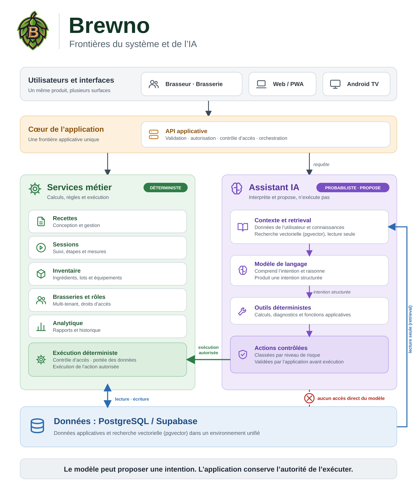

# Pascal Gauthier — Ingénieur qualité principal

**Qualité et gouvernance de l'ingénierie assistée par IA**
*Je conçois, je spécifie et je vérifie, y compris le travail des agents.*

Plus de 25 ans en assurance qualité et en leadership (Ubisoft, Warner Bros Games, un grand groupe
financier). Plus récemment, je travaille à l'adoption de l'IA en développement logiciel : créer les
conditions techniques, méthodologiques et humaines pour en faire des pratiques concrètes, maîtrisées
et durables. Je suis resté proche du technique : ce dépôt le montre.

Je conçois des produits où l'IA propose et où l'application décide. Les composants probabilistes
vivent derrière des frontières déterministes, avec des tests, une chaîne de livraison et une
sécurité traités comme des exigences de conception, pas comme une finition. Je suis l'humain dans
la boucle : les agents écrivent, c'est moi qui décide ce qui est correct.

**À l'écoute d'opportunités.** Un rôle de contributeur technique avec influence : construire les
cadres, pratiques et environnements qui permettent aux équipes d'intégrer l'IA à l'ingénierie
logicielle de façon responsable. Grand Montréal en hybride, ou télétravail.

**À voir en premier.** [Brewno](#brewno), en production pour un utilisateur (moi) ·
[Un test de parité exécutable](projects/brewno/exemple-test-parite/README.md) (`pnpm test`, 1 minute)

**GitHub** : [github.com/Marogold](https://github.com/Marogold) · **LinkedIn** : [linkedin.com/in/gauthierpascal](https://www.linkedin.com/in/gauthierpascal/)

**Stack** : React · Vite · Fastify · Capacitor · PostgreSQL / Supabase (pgvector) · Prisma · Vitest · Playwright · fast-check · GitHub Actions · Vercel

> [!NOTE]
> Ce dépôt est une vue publique choisie de mon travail : **architecture, décisions, preuves**.
> Le code source des projets reste privé. Chaque projet est présenté de façon autonome dans son
> propre dossier sous [`projects/`](projects/).

---

## Navigation rapide

| Si vous avez… | Allez à |
|---|---|
| 1 minute | [Les projets](#projets) |
| 5 minutes | [Les chiffres](#chiffres-clés) et [les cinq décisions d'architecture](projects/brewno/decisions.md) |
| Envie de voir comment je pense | [Les diagrammes](#architecture), [la méthode](#méthode-de-travail-avec-des-agents) et [les principes](#principes-et-limites) |

---

## Projets

| Projet | En une phrase | Statut | Fiche |
|---|---|---|---|
| [Brewno](#brewno) *(anciennement BrewMaster Pro)* | Assistant IA pour brasseurs : le modèle propose, l'application décide | En production, usage personnel | [Dossier](projects/brewno/README.md) |
| [Memory-Cortex](#memory-cortex) | Mémoire projet pour le travail assisté par agents | En développement | [Dossier](projects/memory-cortex/README.md) |

---

## Brewno

*Anciennement BrewMaster Pro.*

> Parler à son application en langage naturel, sans qu'un modèle de langage puisse corrompre les données.

| | |
|---|---|
| **Statut** | En production, utilisé en conditions réelles pour mes brassins personnels. Pas encore d'utilisateurs externes ; le lancement officiel est à l'étude, conditionné aux obligations légales. |
| **Mon rôle** | Product owner, validateur humain et client. J'apporte les idées et les arbitrages, je valide chaque proposition, la recette et la promotion. Les agents consolident, implémentent, testent et déploient. |
| **Surfaces** | Web / PWA, Android, Android TV (testées sur trois profils distincts) |
| **Stack** | React · Vite · Fastify · Capacitor · PostgreSQL / Supabase · Prisma |
| **Dossier complet** | [Fiche projet](projects/brewno/README.md) · [Décisions](projects/brewno/decisions.md) · [Architecture](projects/brewno/architecture/) |

**Le problème.** Un brasseur veut agir sur sa session (ajouter un ingrédient, lancer un minuteur,
consulter son stock) en langage naturel, sans qu'un modèle de langage puisse corrompre ses données.

**L'approche.** Le modèle interprète et propose une intention structurée. L'application la valide,
détermine son niveau de risque (lecture, modification, action sensible) et seuls les services
métier exécutent. Il n'existe aucun chemin entre le modèle et la base de données. Disposer d'une
capacité ne veut pas dire que l'IA doit agir : l'application garde l'autorité de l'exécuter.

### Architecture

  

Du langage naturel à l'action contrôlée

Trois niveaux de risque : lecture (exécution directe), modification (validation selon le contexte),
action sensible (proposition seulement, confirmation explicite requise).

### Chiffres clés

*Relevé statique du dépôt privé, état du commit `927d005c` (2026-11-08), produit par un script.*

| Mesure | Valeur |
|---|---|
| Historique | environ 2 000 commits en 15 semaines |
| Tests | 433 fichiers de tests, environ 4 100 cas (comptage statique) |
| E2E | 36 fichiers, 196 cas (appels `test()` statiques) |
| Données | 36 modèles, 63 migrations versionnées |
| Livraison | 22 workflows CI/CD, 88 actions sur 88 épinglées par empreinte SHA |
| Documentation | 189 pages sous `docs/`, liens vérifiés automatiquement |

### Ce qui est démontré

- **IA encadrée.** Intention structurée, trois niveaux de risque, confirmation explicite pour les
  actions sensibles, aucun accès direct modèle → base.
- **Contexte et retrieval.** PostgreSQL / Supabase avec recherche vectorielle (pgvector) pour le
  contexte applicatif.
- **Qualité à plusieurs niveaux.** Unitaire, intégration, contrat d'API, base de données, E2E
  mockés et E2E réels, tests de propriétés sur les calculs, fuzzing ciblé de l'authentification.
  La CI est elle-même testée (21 fichiers de tests dédiés).
- **Livraison gouvernée.** Environnement de recette, UAT humaine, promotion explicite vers la
  production.
- **AppSec dans le cycle.** Détection de secrets bloquante en PR (Gitleaks), SAST informatif
  (Semgrep Cloud), surveillance des dépendances (Dependabot), permissions CI explicites sur
  20 workflows sur 22.

### Cinq décisions d'architecture

Chacune est détaillée (contexte, options écartées, limite assumée) dans
[`decisions.md`](projects/brewno/decisions.md).

1. **Dupliquer des formules, puis les verrouiller par un test de parité**, plutôt que d'élargir un correctif en refonte.
2. **Séparer les E2E mockés des E2E réels.** Un vert qui ne testait pas l'authentification réelle avait laissé passer un bug en production.
3. **Déléguer l'authentification** à un fournisseur dédié, pour réduire la surface de sécurité maintenue soi-même.
4. **Une seule entité d'assistance**, conçue pour des mains gantées et une télécommande, avec une écoute toujours déclenchée explicitement.
5. **Des erreurs visibles, jamais de faux zéros.** Un échec de chargement n'est pas une liste vide.

---

## Memory-Cortex

> Couche de mémoire projet pour le travail assisté par agents.

| | |
|---|---|
| **Statut** | En développement. La direction (réduire le couplage du contexte projet aux outils et aux agents) n'est pas revendiquée comme livrée. |
| **Principe** | Le Markdown versionné dans Git fait foi ; l'index de rappel en est dérivé, jetable et reconstructible. |
| **Dossier complet** | [Fiche projet](projects/memory-cortex/README.md) |

---

## Méthode de travail avec des agents

Le développement est assisté par des agents, mais **gouverné**. L'IA qui construit le produit est
distincte de l'IA dans le produit.

1. un besoin et un brainstorm avec les agents,
2. une proposition consolidée, validée par un humain,
3. des tests et une livraison en environnement de recette,
4. une UAT humaine,
5. la promotion.

La mémoire projet est consultée selon le domaine de la tâche. Les agents la lisent et n'écrivent
pas dans l'index : ce qu'ils retiennent passe par une revue en diff.

  

---

## Principes et limites

**Principes d'ingénierie**

- **Frontières explicites.** Séparer raisonnement probabiliste, autorité applicative et exécution déterministe.
- **Confiance vérifiable.** Une affirmation sans test, contrôle automatisé ou revue n'est pas publiée.
- **Sécurité dans le cycle.** Intégrée au développement et à la CI, pas seulement en aval.
- **Divulgation maîtrisée.** Architecture et décisions oui ; secrets, configurations, prompts et mécanismes internes non.

> [!IMPORTANT]
> **Limites assumées.**
> Brewno n'a pas encore d'utilisateurs externes. Le SAST est informatif et non bloquant.
> Deux workflows sur 22 n'ont pas encore de bloc de permissions explicite.
> Memory-Cortex est en développement.
> Le code étant privé, les chiffres ci-dessus sont des relevés de l'auteur, datés et produits par
> script, mais non vérifiables de l'extérieur.

---

## Contact

[LinkedIn](https://www.linkedin.com/in/gauthierpascal/) · [GitHub](https://github.com/Marogold)
