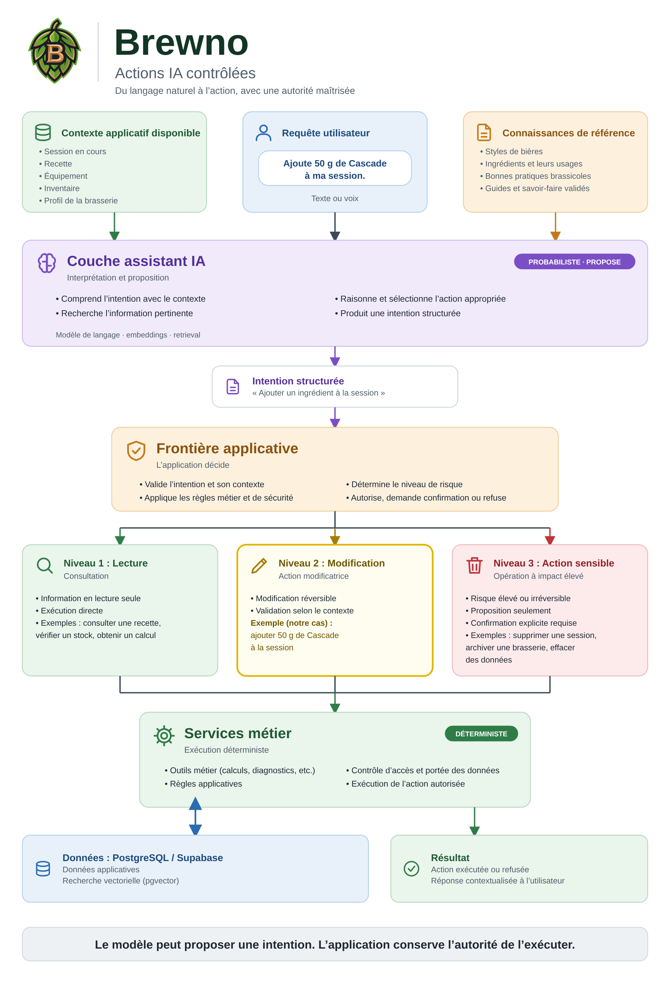
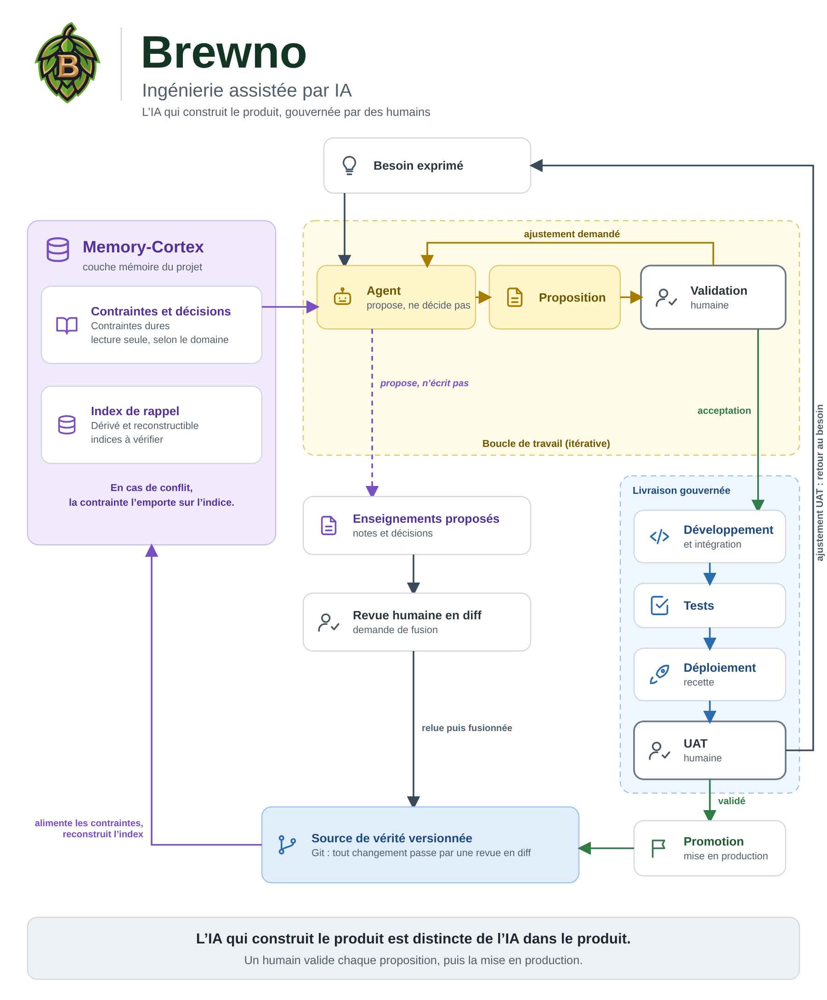

# Pascal Gauthier — Ingénierie Qualité & IA

Je construis des produits où l'IA propose et où l'application décide. Les composants probabilistes
vivent derrière des frontières déterministes, avec des tests, une chaîne de livraison et une
sécurité traités comme des exigences de conception, pas comme une finition.

**GitHub** : [github.com/Marogold](https://github.com/Marogold) · **LinkedIn** : [linkedin.com/in/gauthierpascal](https://www.linkedin.com/in/gauthierpascal/)

**Stack** : React · Vite · Fastify · Capacitor · PostgreSQL / Supabase (pgvector) · Prisma · Vitest · Playwright · fast-check · GitHub Actions · Vercel

> [!NOTE]
> Ce dépôt est une vue publique choisie de mon travail : **architecture, décisions, preuves**.
> Le code source des projets reste privé. Chaque projet est présenté dans son propre dossier
> sous [`projects/`](projects/), de façon autonome.

---

## Navigation rapide

| Si vous avez… | Allez à |
|---|---|
| 1 minute | [Les projets](#projets) |
| 5 minutes | [Les chiffres](#brewmaster-pro) et [les 5 décisions d'architecture](projects/brewmaster-pro/decisions.md) |
| Envie de voir comment je pense | [Les diagrammes](#architecture) et [les principes](#principes-et-limites) |

---

## Projets

| Projet | En une phrase | Statut | Fiche |
|---|---|---|---|
| [BrewMaster Pro](#brewmaster-pro) | Assistant IA pour brasseurs : le modèle propose, l'application décide | Actif, mais non partagé <!-- À CONFIRMER : en production ? --> | [Dossier](projects/brewmaster-pro/README.md) |
| [Memory-Cortex](#memory-cortex) | Mémoire projet pour le travail assisté par agents | En développement | [Dossier](projects/memory-cortex/README.md) |

---

## BrewMaster Pro

> Parler à son application en langage naturel, sans qu'un modèle puisse corrompre les données.
> Produit aussi nommé **Brewno**. <!-- À DÉCIDER : un seul nom public + "anciennement" -->

| | |
|---|---|
| **Statut** | Actif, non partagé · développement depuis 2026-07-26 |
| **Surfaces** | Web / PWA, Android, Android TV (testées sur trois profils distincts) |
| **Mon rôle** | Conception, développement, QA, livraison <!-- À CONFIRMER --> |
| **Stack** | React · Vite · Fastify · Playwright · Capacitor · PostgreSQL · Semgrep / Supabase · Prisma |
| **Dossier complet** | [Fiche projet](projects/brewmaster-pro/README.md) · [Décisions](projects/brewmaster-pro/decisions.md) · [Architecture](projects/brewmaster-pro/architecture/) |

**Le problème.** Un brasseur veut agir sur sa session (ajouter un ingrédient, lancer un minuteur,
consulter son stock) en langage naturel, sans qu'un modèle de langage puisse corrompre ses données.

**L'approche.** Le modèle interprète et propose une intention structurée. L'application la valide,
détermine son niveau de risque (lecture, modification, action sensible) et seuls les services
métier exécutent. Il n'existe aucun chemin entre le modèle et la base de données. Disposer d'une
capacité ne veut pas dire que l'IA doit agir : l'application garde l'autorité de l'exécuter.

### Architecture

  

Deux autres diagrammes

**Actions IA contrôlées**

### Chiffres clés

*Relevé statique dans le dépôt privé, 2026-11-09.*

| Mesure | Valeur |
|---|---|
| Historique | environ 2 000 commits en 15 semaines |
| Tests | 368 fichiers de tests, environ 4 200 cas (comptage statique) |
| E2E | 65 scénarios |
| Données | 36 modèles, 64 migrations, 74 .sql |
| Livraison | 22 workflows CI/CD, 88 actions épinglées par empreinte SHA |
| Documentation | 189 pages sous `docs/`, liens vérifiés automatiquement (pour les projets) |

### Ce qui est démontré

- **IA encadrée.** Intention structurée, trois niveaux de risque, confirmation explicite pour les
  actions sensibles, aucun accès direct modèle → base.
- **Contexte et retrieval.** PostgreSQL / Supabase avec recherche vectorielle (pgvector) pour le
  contexte applicatif.
- **Qualité à plusieurs niveaux.** Unitaire, intégration, contrat d'API, base de données, E2E
  mockés et E2E réels, tests de propriétés sur les calculs, fuzzing ciblé de l'authentification.
  La CI est elle-même testée.
- **Livraison gouvernée.** Environnement de recette, UAT humaine, promotion explicite vers la
  production.
- **AppSec dans le cycle.** Détection de secrets bloquante en PR (Gitleaks), SAST informatif
  (Semgrep Cloud), surveillance des dépendances (Dependabot), permissions CI explicites sur
  20 workflows sur 22.

### Cinq décisions d'architecture

Chacune est détaillée (contexte, options écartées, limite assumée) dans
[`decisions.md`](projects/brewmaster-pro/decisions.md).

1. **Dupliquer des formules, puis les verrouiller par un test de parité**, plutôt que d'élargir un correctif en refonte.
2. **Séparer les E2E mockés des E2E réels.** Un vert qui ne testait pas l'authentification réelle avait laissé passer un bug en production.
3. **Déléguer l'authentification** à un fournisseur dédié, pour réduire la surface de sécurité maintenue soi-même.
4. **Une seule entité d'assistance**, conçue pour des mains gantées et une télécommande, avec une écoute toujours déclenchée explicitement.
5. **Des erreurs visibles, jamais de faux zéros.** Un échec de chargement n'est pas une liste vide.

---

## Memory-Cortex

> Couche de mémoire projet pour le travail assisté par agents.

| | |
|---|---|
| **Statut** | En développement |
| **Dossier complet** | [Fiche projet](projects/memory-cortex/README.md) |

---

## Méthode de travail avec des agents

Le développement est assisté par des agents, mais **gouverné** :

1. un besoin,
2. une boucle de proposition validée par un humain,
3. des tests et une livraison en environnement de recette,
4. une UAT humaine,
5. la promotion.

La mémoire projet est consultée selon le domaine de la tâche. Les agents la lisent et n'écrivent
pas dans l'index : ce qu'ils retiennent passe par une revue en diff.

  

---

## Principes et limites

**Principes d'ingénierie**

- **Frontières explicites.** Séparer raisonnement probabiliste, autorité applicative et exécution déterministe.
- **Confiance vérifiable.** Une affirmation sans test, contrôle automatisé ou revue n'est pas publiée.
- **Sécurité dans le cycle.** Intégrée au développement et à la CI, pas seulement en aval.
- **Divulgation maîtrisée.** Architecture et décisions oui ; secrets, configurations, prompts et mécanismes internes non.

> [!IMPORTANT]
> **Limites assumées.** Le SAST est informatif et non bloquant. Memory-Cortex est en développement.
> Deux workflows sur 22 n'ont pas encore de bloc de permissions explicite.
> Le code étant privé, les chiffres ci-dessus sont des relevés de l'auteur, datés, et non
> vérifiables de l'extérieur.

---

## Contact

[LinkedIn](https://www.linkedin.com/in/gauthierpascal/) · [GitHub](https://github.com/Marogold)
