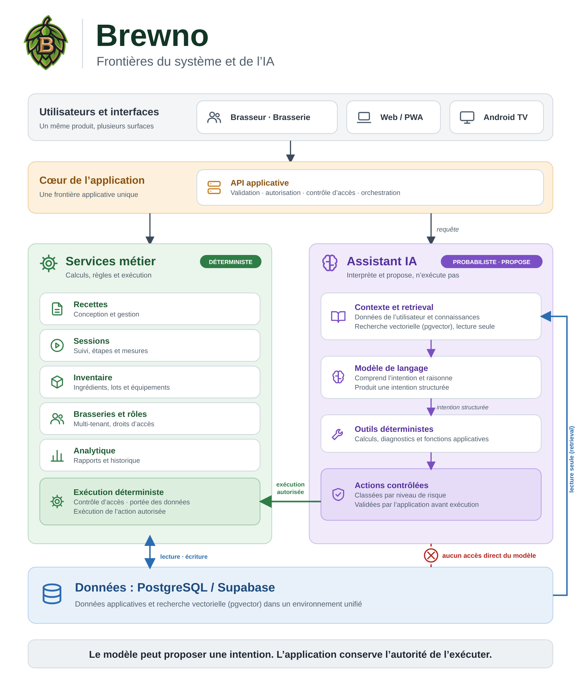
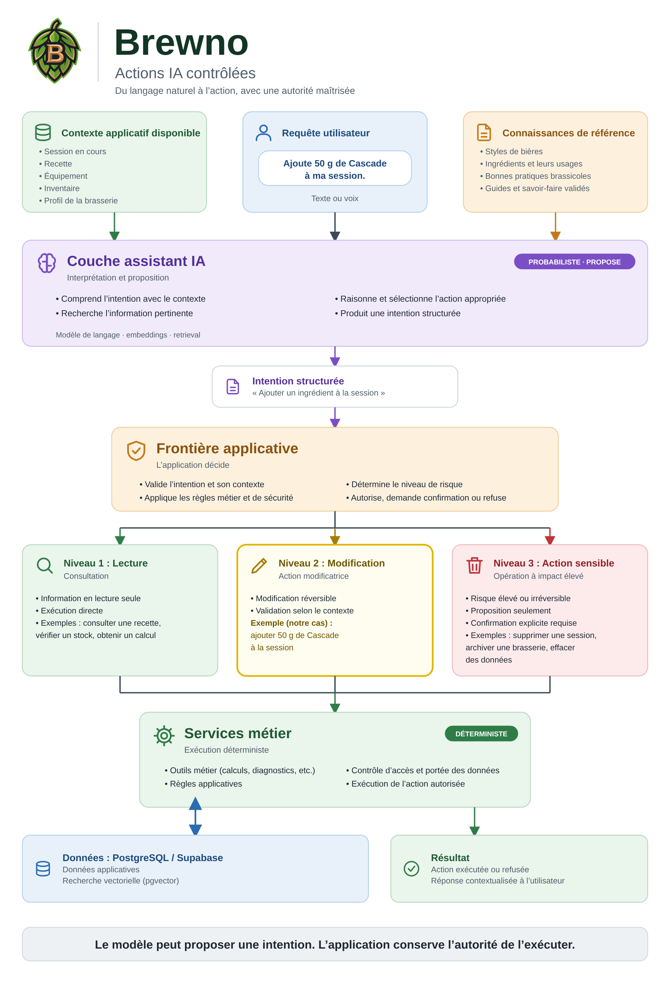
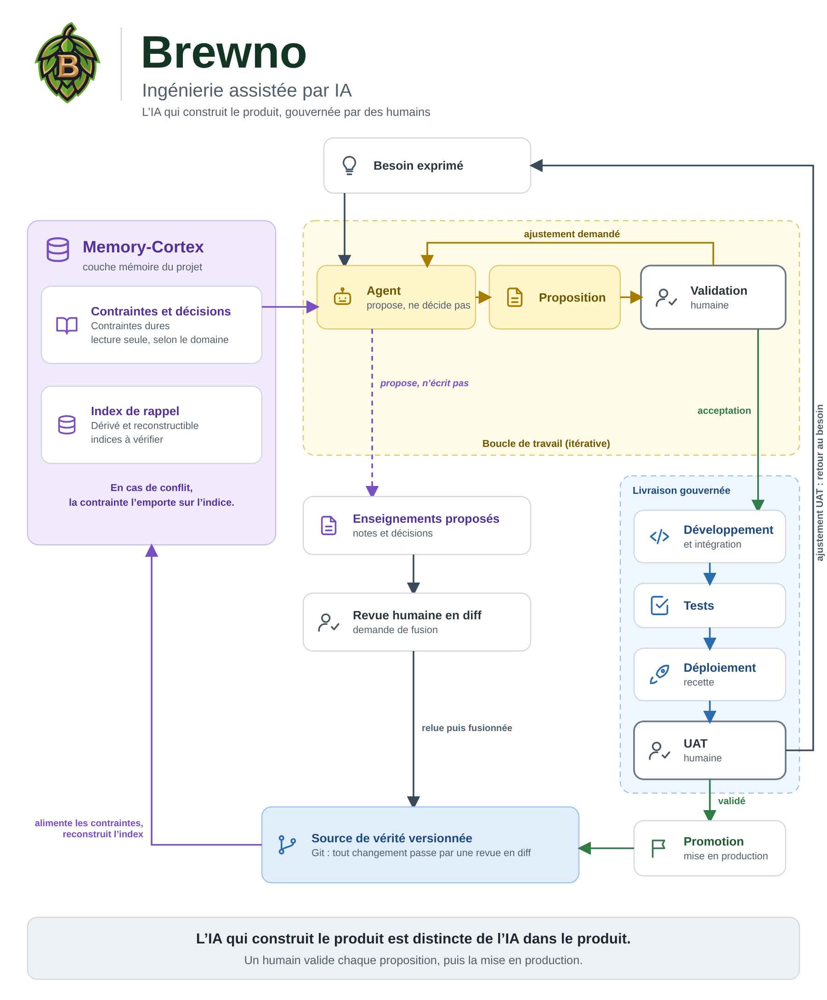

# BrewMaster Pro / Brewno

Plateforme d'assistance au brassage (produit **Brewno**) : domaine métier déterministe et assistance
IA encadrée. Le code source est privé ; cette page présente l'architecture, les décisions et les
preuves.

← [Retour au portfolio](../../README.md)

## Le problème et l'approche

Un brasseur veut agir sur sa session en langage naturel, sans qu'un modèle de langage puisse
corrompre ses données. Le modèle **interprète et propose** ; l'application **valide, classe le
risque et décide** ; seuls les services métier **exécutent**. Aucun chemin ne relie le modèle à la
base de données.

## Architecture

### Frontières du système et de l'IA

Le modèle (probabiliste) propose ; les services métier (déterministes) exécutent. Le retrieval est
en lecture seule, et le modèle n'a aucun accès direct à la base.

### Du langage naturel à l'action contrôlée

Trois niveaux de risque : lecture (exécution directe), modification (validation selon le contexte),
action sensible (proposition seulement, confirmation explicite requise).

### Comment le produit est construit avec des agents

L'IA qui construit le produit est distincte de l'IA dans le produit. Un humain valide chaque
proposition, puis la mise en production. La mémoire projet est en lecture seule pour l'agent ;
ce qu'il retient passe par une revue en diff.

Versions vectorielles : fichiers `.svg` du même dossier.

## Preuves

- **Qualité à plusieurs niveaux** : unitaire, intégration, contrat d'API, base de données, E2E
  mockés et E2E réels, tests de propriétés sur les calculs, fuzzing ciblé de l'authentification.
  Trois profils d'exécution (web, Android, Android TV).
- **Livraison gouvernée** : environnement de recette, UAT humaine, promotion explicite vers la
  production.
- **AppSec dans le cycle** : détection de secrets bloquante en PR, SAST informatif, surveillance des
  dépendances, actions CI épinglées par empreinte SHA.
- **Chiffres** : voir le [tableau du README racine](../../README.md#brewmaster-pro--brewno-en-chiffres).
- **Décisions** : [cinq décisions d'architecture détaillées](decisions.md).

## Limites assumées

- Le SAST est informatif et ne bloque pas.
- Deux workflows CI sur 22 n'ont pas de bloc de permissions explicite.
- Les décisions listées dans [decisions.md](decisions.md) disent aussi ce qu'elles ne couvrent pas.
