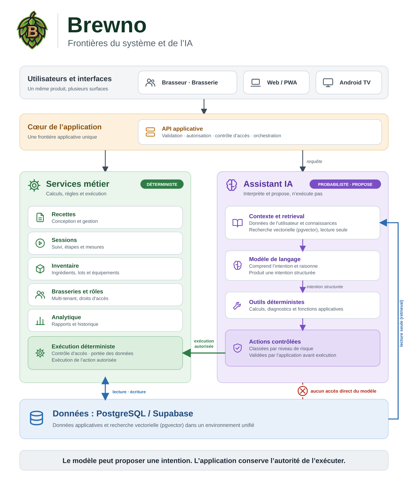
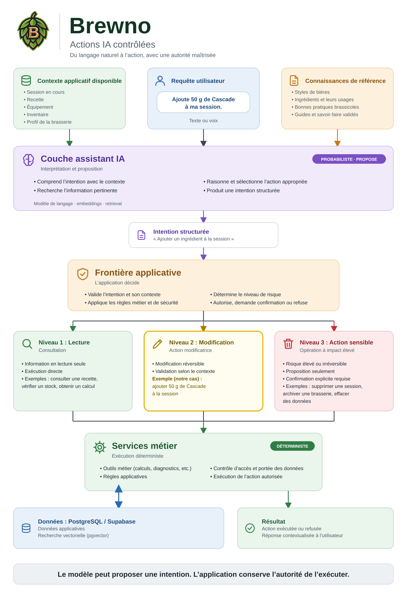
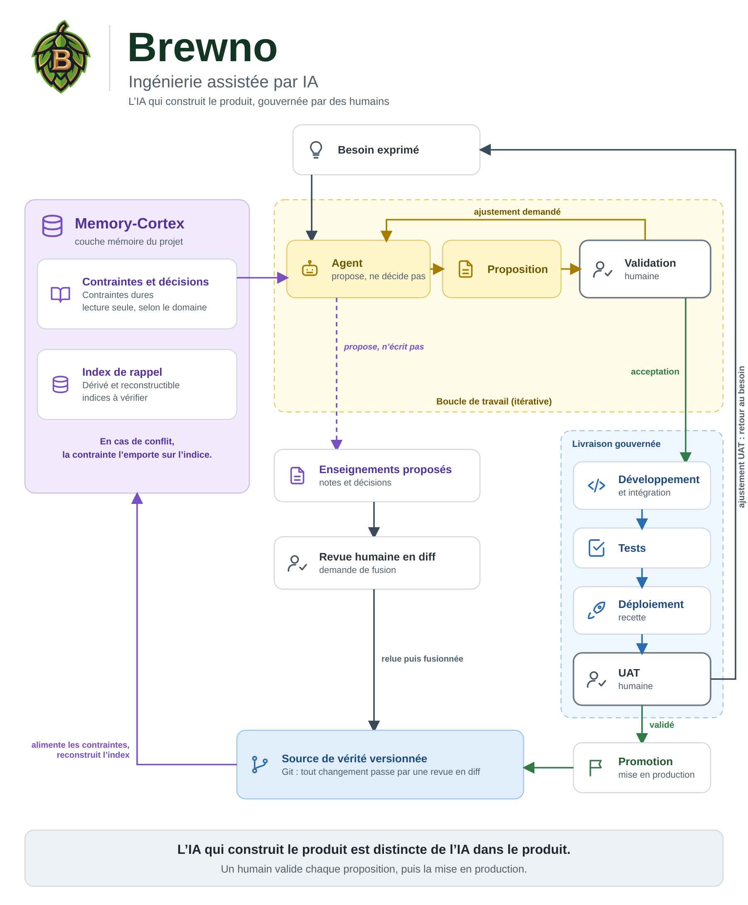

# Brewno

*Anciennement BrewMaster Pro.*

Plateforme d'assistance au brassage : domaine métier déterministe et assistance IA encadrée. Le code
source est privé ; cette page présente l'architecture, les décisions et les preuves.

← [Retour au portfolio](../../README.md)

| | |
|---|---|
| **Statut** | En production, utilisé en conditions réelles pour mes brassins personnels. Pas encore d'utilisateurs externes ; le lancement officiel est à l'étude, conditionné au financement et aux obligations légales. |
| **Mon rôle** | Product owner et validateur humain. J'apporte les idées et les arbitrages, je valide chaque proposition, la recette et la promotion. Les agents consolident, implémentent, testent et déploient. |
| **Surfaces** | Web / PWA, Android, Android TV (testées sur trois profils distincts) |
| **Stack** | React · Vite · Fastify · Capacitor · PostgreSQL / Supabase (pgvector) · Prisma · Vitest · Playwright · fast-check |

## Le problème et l'approche

Un brasseur veut agir sur sa session en langage naturel, sans qu'un modèle de langage puisse
corrompre ses données. Le modèle **interprète et propose** ; l'application **valide, classe le
risque et décide** ; seuls les services métier **exécutent**. Aucun chemin ne relie le modèle à la
base de données.

## Architecture

### Frontières du système et de l'IA

Le modèle (probabiliste) propose ; les services métier (déterministes) exécutent. Le retrieval est
en lecture seule, et le modèle n'a aucun accès direct à la base.

### Du langage naturel à l'action contrôlée

Trois niveaux de risque : lecture (exécution directe), modification (validation selon le contexte),
action sensible (proposition seulement, confirmation explicite requise).

### Comment le produit est construit avec des agents

L'IA qui construit le produit est distincte de l'IA dans le produit. Un humain valide chaque
proposition, puis la mise en production. La mémoire projet est en lecture seule pour l'agent ;
ce qu'il retient passe par une revue en diff.

Cliquez sur un diagramme pour ouvrir sa version vectorielle (`.svg`), nette à tout niveau de zoom.

## Chiffres

*Relevé statique du dépôt privé, 2026-11-15 (commit `927d005c`), produit par un script. Le dépôt
étant privé, ces chiffres sont des relevés de l'auteur, non vérifiables de l'extérieur.*

| Mesure | Valeur | Méthode |
|---|---|---|
| Historique | 1 985 commits, 16 semaines | `git rev-list --count HEAD`, depuis le premier commit (2026-07-26) |
| Fichiers de tests | 433 | fichiers `*.test` ou `*.spec` suivis par git |
| Cas de tests | environ 4 100 | occurrences de `it(` et `test(` ; comptage statique approximatif |
| E2E | 36 fichiers, 213 cas | sous `tests/e2e` ; comptage statique |
| Tests de la CI elle-même | 21 fichiers | sous `tests/unit/ci` |
| Workflows CI/CD | 22 | `.github/workflows` |
| Actions épinglées par SHA | 88 sur 88 | références `uses:` externes terminées par une empreinte de 40 caractères |
| Permissions CI explicites | 20 workflows sur 22 | présence d'un bloc `permissions:` |
| Modèles de données | 36 | déclarations `model` dans le schéma Prisma |
| Migrations | 63 dossiers (74 fichiers SQL) | dossiers de migration contenant du SQL |
| Documentation | 189 pages `.md` sous `docs/` (184 hors archive) | fichiers Markdown suivis |

## Preuves

- **Qualité à plusieurs niveaux** : unitaire, intégration, contrat d'API, base de données, E2E
mockés et E2E réels, tests de propriétés sur les calculs, fuzzing ciblé de l'authentification.
Trois profils d'exécution (web, Android, Android TV). La CI est elle-même testée.
- **Livraison gouvernée** : environnement de recette, UAT humaine, promotion explicite vers la
production.
- **AppSec dans le cycle** : détection de secrets bloquante en PR, SAST informatif, surveillance des
dépendances, actions CI épinglées par empreinte SHA.
- **Décisions** : [cinq décisions d'architecture détaillées](decisions.md).

## Limites assumées

- Brewno n'a pas encore d'utilisateurs externes.
- Le SAST est informatif et ne bloque pas.
- Deux workflows CI sur 22 n'ont pas de bloc de permissions explicite.
- Les décisions listées dans [decisions.md](decisions.md) disent aussi ce qu'elles ne couvrent pas.
