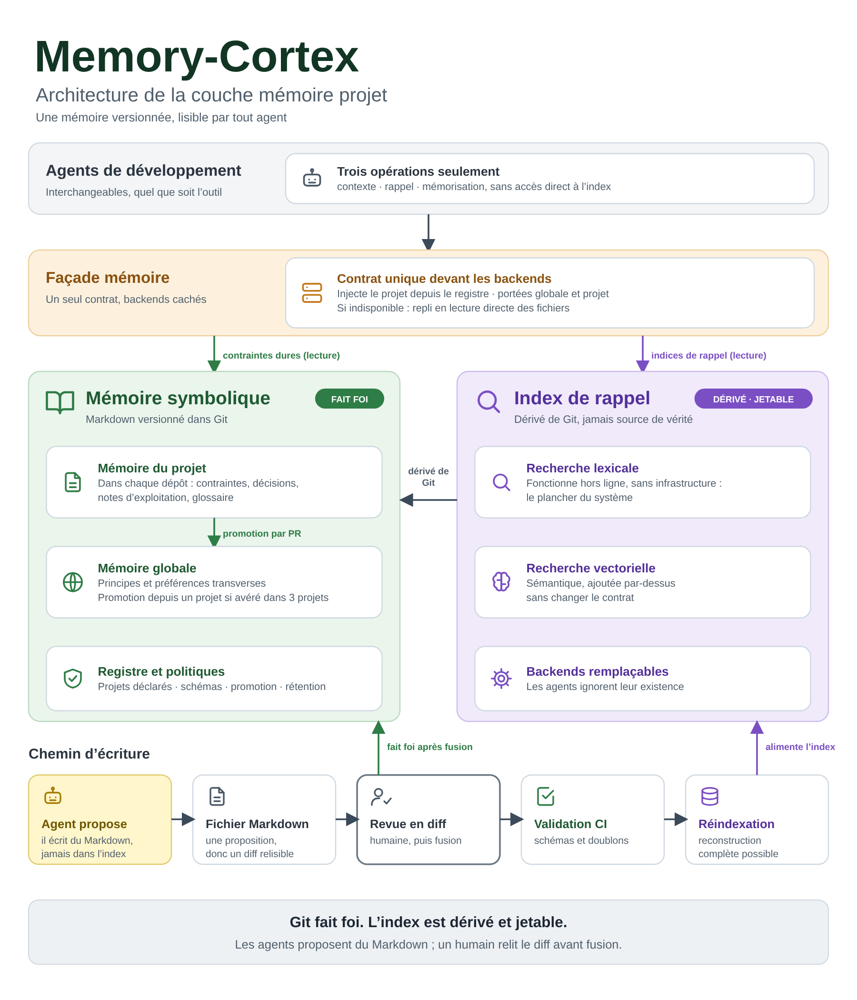

# Memory-Cortex

Couche de mémoire projet pour le travail assisté par agents. Utilisée sur deux de mes projets.

← [Retour au portfolio](../../README.md)

## Architecture

Une mémoire partagée par plusieurs projets et lisible par n'importe quel agent. Le Markdown versionné
dans Git fait foi ; l'index de rappel en est dérivé. Les agents passent par une façade unique qui
cache les backends, et ne modifient la mémoire qu'en proposant du Markdown relu en diff.
Version vectorielle : [`.svg`](architecture/ARCH-PUBLIC-004.svg).

## État au 2026-11-17

*Relevé du dépôt privé, état du commit `def4845` (2026-11-13). Le dépôt étant privé, ces constats
sont des relevés de l'auteur, non vérifiables de l'extérieur.*

### Livré et vérifié

| Fonction | Comment c'est vérifié |
|---|---|
| Suite de tests de l'outillage : **96 tests, 0 échec** | `npm run check` (lint global, détection de doublons, tests), rejoué le 2026-11-17 |
| Façade de rappel qui **démarre hors ligne, sans infrastructure** (recherche lexicale BM25) | Instance isolée démarrée sans backend vectoriel : l'état de santé indique le pilote lexical, vectoriel indisponible. Rejoué le 2026-11-17 |
| Recherche vectorielle optionnelle, **active sur mon poste** | État de santé d'une instance en cours d'exécution : vectoriel disponible. Observé le 2026-11-17 |
| Serveur MCP exposant **trois outils** (contexte, rappel, enregistrement) | Lecture du code : trois déclarations |
| Outil en ligne de commande : **dix commandes hors ligne** (validation, déduplication, génération d'index, proposition de commit, promotion, hygiène…) et trois en ligne | Aide intégrée de l'outil. La commande de proposition ne fait aucune opération Git automatique |
| **L'enregistrement d'un souvenir n'écrit pas dans l'index** : il produit un fichier Markdown, relu en diff | Lecture du gestionnaire : une écriture de fichier, aucun appel d'indexation |
| Détection de quasi-doublons à l'écriture, seuil de similarité configurable | Lecture du code (seuil par défaut dans la façade) |
| Hygiène hebdomadaire : un rapport et **une seule issue** tenue à jour | Workflow planifié (une fois par semaine) ; seules les commandes de lecture, création et mise à jour de l'issue y sont appelées |

### Principes de conception (documentés, non rejoués ici)

- Le Markdown versionné fait foi ; l'index de rappel est dérivé, jetable et reconstructible.
- Deux portées, globale et par projet, sans copie de l'une vers l'autre.
- Les contraintes dures l'emportent sur les indices de rappel.

### Pas encore

- **Promotion vers le global.** La commande existe et est couverte par la suite de tests, mais sa
  règle de déclenchement (le même fait avéré dans **trois** projets) ne peut pas se produire : le
  registre compte deux projets.
- **Promotion automatique.** Le job d'hygiène produit un rapport ; il n'ouvre aucune demande de
  fusion. Promouvoir reste une décision et un geste humains.
- **Reclassement des résultats de rappel** : non disponible.
- **Mesure publiée de l'apport du vectoriel.** Un écart entre rappel lexical et vectoriel est
  consigné dans la documentation interne ; je ne l'ai pas rejoué, je ne le reprends donc pas ici.
- **Usage à l'échelle.** Deux projets, un seul utilisateur : moi.

## Direction

Réduire le couplage du contexte projet aux outils et aux agents. Cette direction n'est **pas**
revendiquée comme livrée.

## Voir aussi

- [Comment le produit est construit avec des agents](../brewno/architecture/ARCH-PUBLIC-003.png)
